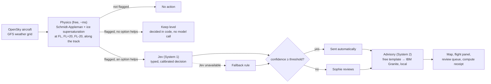

# TrailSense

**A frugal AI agent that helps airline dispatchers avoid climate-warming contrails.**
McGill CodeJam 16 (Nov 20-22, 2026) · target track: **Agent Solution** · Hedi Amara & Dawud

**Live demo → https://pixel-perfect-screenshot-muse-09.lovable.app/**
Real aircraft (OpenSky) and real weather (GFS) recorded over Eastern Canada during the hackathon, with real Jev decisions.


---

## The problem
- **Contrails are aviation's biggest climate lever after fuel.** Contrail cirrus is the largest single term of aviation's climate forcing: about 57% of its net effective radiative forcing in 2018 (57.4 of 100.9 mW/m², wide uncertainty range), more than aviation's CO₂ (34.3) ([Lee et al., 2021](https://doi.org/10.1016/j.atmosenv.2020.117834)).
- **A few flights cause most of it.** Persistent contrails only form in thin, ice-supersaturated layers, so moving a flight 2,000 ft up or down is often enough.
- **It works on the flights that follow the plan** (−54% contrails in a 2023 Google / American Airlines test; −62% in a 2025 randomised trial), **but adoption is the bottleneck:** only 112 of ~1,200 eligible flights flew the avoidance plan, so the whole group saw −11.6% ([Sankar et al., 2026](https://arxiv.org/abs/2603.06909)). The dispatcher has to know *which* flight, *which* level, and *whether to trust the forecast*: that is the problem TrailSense addresses. All quoted numbers are checked in [`docs/fact_check.md`](docs/fact_check.md).
- **Doing that with a big LLM on every flight is slow, expensive and unreliable.** Our benchmark below shows it.

## What it does
Sophie is a dispatcher. Every cycle, TrailSense scans every aircraft in cruise over her region and only bothers her when it matters:

1. **Physics finds the few flights that will leave a persistent contrail** (free, a few milliseconds for 40 aircraft).
2. **Jev decides** climb, descend or keep level, with a calibrated confidence.
3. **The autonomy threshold routes the decision:** confident → advisory sent automatically; unsure → Sophie reviews it.
4. **An advisory is written** by the cheapest model that can do it, and a **compute receipt** shows what the cycle cost.

## How it works: think fast, then slow


- **Physics** (`backend/physics/`, Dawud): Schmidt-Appleman criterion for formation, ice supersaturation (RHi ≥ 95%) for persistence, the length of the supersaturated region measured along the aircraft's heading, fuel penalty and CO₂e avoided ([Borella et al., 2024](https://acp.copernicus.org/articles/24/9401/2024/)). All assumptions: [`docs/hypotheses.md`](docs/hypotheses.md).
- **Jev** (`backend/agent/jev.py`): [TypeSafe AI](https://typesafe.ai/)'s non-generative "System One" model gets a compact state (levels, humidity, fuel, net benefit, forecast margin) and 4 typed questions. It does no arithmetic: it chooses, and says how sure it is. If no option has a positive net benefit, the code decides "keep level" without calling Jev.
- **Forecast guardrail, measured and kept off** (`fallback.route_for`, `config.MIN_FORECAST_RELIABILITY`): it would send any climb or descent to Sophie when Jev doubts the weather forecast. On every recorded cycle Jev rates the GFS humidity forecast "low" (0.01-0.11), because GFS caps humidity at 100%, right at our 95% threshold. Turned on, it would send every move to review, so the high autonomy threshold does that job instead. It is one setting to turn on with a better humidity forecast.
- **Fallback rule** (`backend/agent/fallback.py`): same output as Jev, used automatically if Jev is unreachable, so the demo cannot break. The interface always says who decided.
- **Writers** (`backend/agent/writer.py`): a free template for every advisory; [IBM Granite 4 micro](https://ollama.com/library/granite4) running **locally** (Ollama) rewrites the important ones in plain language. A guard rejects any advisory containing a number that is not in the facts. Apart from Jev's API call, everything runs on the laptop.

## Results

### Benchmark: TrailSense vs an all-LLM agent, same flights, same data
The all-LLM agent gets each aircraft and its weather profile and does everything itself (one local Granite call per aircraft). Measured on a laptop, `scripts/run_benchmark.py`, full output in [`data/benchmark/latest.json`](data/benchmark/latest.json).

<!-- BENCHMARK-TABLE -->
| 3 recorded cycles, 60 flights, 3 flagged | All-LLM agent | TrailSense | |
|---|---|---|---|
| Model calls | 60 | 6 (3 Jev + 3 Granite) | **10× fewer** |
| Time | 23 min 23 s | 52 s | **27× faster** |
| Local energy (est.) | 8.55 Wh | 0.28 Wh | **30× less** |
| Contrails found (physics = reference) | 3/3 | 3/3 | |
| **False alarms** | **57 of 57** clear flights | 0 | |
| Right action on the flagged flights | 2/3 (UPS214: climb, the option with no benefit) | 3/3 | |
<!-- /BENCHMARK-TABLE -->

**Stress test, Europe** (3 cycles, 60 flights of which **38 flagged**, because the benchmark picks flagged flights first; full output in [`data/benchmark/europe.json`](data/benchmark/europe.json)):

| | All-LLM agent | TrailSense | |
|---|---|---|---|
| Model calls | 60 | 43 (29 Jev + 14 Granite) | 1.4× fewer |
| Time | 22 min 33 s | 3 min 4 s | 7.3× faster |
| Local energy (est.) | 8.22 Wh | 0.96 Wh | 8.5× less |
| False alarms | **22 of 22** clear flights | 0 | |
| Same action as TrailSense on flagged flights | **20 / 38** (said "climb" almost every time; moved 9 flights where no option helps) | | |

With most tested flights flagged, TrailSense has to call Jev almost every time, so the efficiency gap shrinks. That is the worst case for us: in the real day cycle only 22 of 451 aircraft are flagged, so the all-LLM agent would need 451 calls where TrailSense made 22. The quality gap grows instead. **Cheaper when the sky is clear, right when it isn't.**

Asked to judge contrails by itself, the all-LLM agent said "persistent contrail" for **every single flight** in both runs: 57 needless, fuel-burning deviations in Canada (plus the wrong direction for UPS214), 22 in Europe. TrailSense's time includes loading the local model once. **Physics first is cheaper *and* more reliable.**

### Jev on the real flagged flights
| Flight (night, Eastern Canada) | Jev's decision | Per-option probability | Route |
|---|---|---|---|
| AAL278 FL330 | climb 2,000 ft, confidence 0.61 | climb 74% · descend 25% · keep 1% | Sophie reviews |
| UAL46 FL330 | climb 2,000 ft, confidence 0.56 | climb 71% · descend 27% · keep 2% | Sophie reviews |
| UPS214 FL320 | descend 2,000 ft, confidence 0.98 | descend 99% · climb 0% · keep 1% | sent automatically |

In **Europe** (Dawud's recordings, ~450 aircraft per cycle) the physics flags 4, 14 (night) and 22 (day) flights in about 37 ms. Jev is confident on most of them (e.g. RUK54ST FL370: climb, 0.96, sent automatically, +3.3 t CO₂e for 13 kg of fuel), and 4-5 per cycle are kept level in code because no option helps: no model call at all.

Where two options are almost equally good (AAL278: +3,737 vs +3,733 kg CO₂e) and the humidity sits just above the threshold, Jev hesitates and hands the flight to a human. Where only one option works, it acts.

### Things we measured and did not keep
- **Grouping all flagged flights into one Jev request:** −67% calls, −15% tokens, but it inflated Jev's confidence (UAL46 0.67 → 0.91, flipping it from review to automatic). Calibration matters more than 15% of tokens, so it is off by default (`JEV_GROUPED` in `backend/config.py`).

## Honest limits
- GFS caps humidity at 100% and represents ice supersaturation poorly; our 95% threshold is a tuning choice. That is exactly why the confidence and the human-review route exist.
- Over the open ocean OpenSky sees almost no aircraft (no ground receivers), so we recorded Eastern Canada and Europe, not the North Atlantic.
- Aircraft type, winds and real traffic are not modelled; the CO₂e factor per km has a ×3 uncertainty range ([`docs/hypotheses.md`](docs/hypotheses.md)).
- The benchmark is a small sample (one flagged flight per cycle) with a small local model (3B parameters). Local Wh = 25 W × generation time (estimate). Jev runs on TypeSafe's servers: we report its calls and tokens, not its energy.
- TrailSense never moves an aircraft: it advises the dispatcher, who requests the level from ATC as usual.

## Run it
```bash
python -m venv .venv && source .venv/bin/activate   # Windows: run scripts/setup_env.py
pip install -r requirements.txt
cp .env.example .env                                  # TYPESAFE_API_KEY (Jev); OpenSky optional
python scripts/run_api.py                             # → http://localhost:8000 (API + simple map)
python -m pytest -q                                   # 31 tests, no network needed
```

**Optional: secrets with [1Password](https://developer.1password.com/docs/cli/secrets-environment-variables/)** (the repo is public): store the Jev key in a vault named `TrailSense` (item `Jev`, field `credential`), then run anything through `op run`. [`.env.1password`](.env.1password) holds only `op://` references, never a key.
```bash
op run --env-file=.env.1password -- python scripts/run_api.py
op run --env-file=.env.1password -- python scripts/export_snapshots.py
```

| Script | What it does |
|---|---|
| `scripts/run_api.py` | FastAPI server: `GET /api/snapshot?mode=replay\|live&threshold=0.8&i=0`, `GET /api/benchmark` |
| `scripts/record_once.py` | Records one cycle of the real sky (OpenSky + Open-Meteo) into `data/replay/` |
| `scripts/setup_granite.py` | Downloads IBM Granite into Ollama and tests one advisory |
| `scripts/try_jev.py`, `try_jev_grouped.py` | One real Jev call; grouped vs one-by-one comparison |
| `scripts/run_benchmark.py` | The benchmark above |
| `scripts/export_snapshots.py` | Exports real cycles for the published demo |
| `python -m backend.physics.scan [region]` | Scans a whole recording for flagged flights (Dawud) |

The published frontend is a separate Lovable project (React / TanStack Start) that bundles the exported cycles; see [`docs/lovable.md`](docs/lovable.md). It can also read this API live (`VITE_API_BASE=http://localhost:8000`).

## Repository map
| Path | Owner | Role |
|---|---|---|
| `backend/sources/` | Dawud | OpenSky aircraft, Open-Meteo weather (cached grid), recorder / replay, multi-region |
| `backend/physics/` | Dawud | Contrail physics, fuel and CO₂e, `assess_cycle()`, scan |
| `backend/agent/` | Hedi | Jev, fallback rule, writers, pipeline |
| `backend/benchmark/` | Hedi | Cascade vs all-LLM |
| `backend/api.py`, `frontend/` | Hedi | API and the simple built-in map |
| `backend/models.py`, `backend/config.py` | both | Data contracts and settings |
| `data/replay/` | Dawud | Recorded cycles used by the demo |

More detail: [`ARCHITECTURE.md`](ARCHITECTURE.md) · plan and progress: [`TASKS.md`](TASKS.md) · pitch physics notes: [`docs/pitch_physics.md`](docs/pitch_physics.md).

## Built with
- **[Jev](https://typesafe.ai/)** (TypeSafe AI): the System 1 decision with calibrated confidence.
- **[IBM Granite](https://www.ibm.com/granite)** via [Ollama](https://ollama.com/): local advisories and the benchmark's LLM.
- **[Lovable](https://lovable.dev/)**: the published frontend.
- **[Cloud LLM](https://www.provider.com/cloud_llm)** (provider): coding assistant throughout the weekend.
- **Data:** [OpenSky Network](https://opensky-network.org/) (aircraft), [Open-Meteo](https://open-meteo.com/) GFS (weather). **Stack:** Python, FastAPI, httpx, Leaflet, React.

## Team
**Hedi Amara**: agent, LLMs, product, frontend · **Dawud**: data, physics, science
